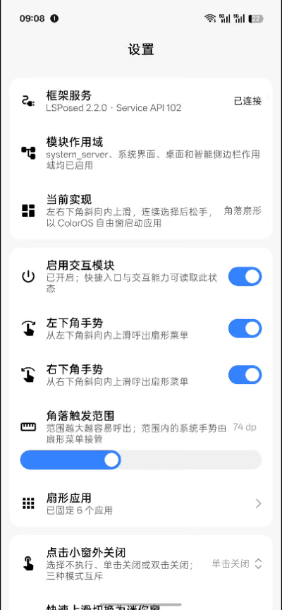

  

<h1 align="center">AicyBox</h1>

  
  
  

> **本仓库是二次开发版（衍生版本），非原作者发布。**
>
> 基于 [Mangi-11/FlymeFreeform](https://github.com/Mangi-11/FlymeFreeform) 修改，
> 主要针对 **ColorOS 17 / Android 17（SDK 37）** 做适配与修复，同时修复若干已知问题。
> 原项目版权归原作者 **Mangi-11** 所有；本项目作为衍生作品，同样以 **GPL-3.0** 授权。
> 想了解原始版本请前往上游仓库；本衍生版的具体改动见下方[「本衍生版的改动」](#本衍生版的改动)。

把 Flyme 小窗的“呼之即来，挥之即去”带到 ColorOS，并入声音气泡、聚合支付与侧滑字母索引的 Xposed（LSPosed）模块。

- 面向 **ColorOS 17 / Android 17（SDK 37）** 适配
- App 提供底部四 Tab：**首页 / 小窗 / 建议 / 索引**
- 改包名 `com.eta.aicybox`（由 FlymeFreeform 衍生）

> 原仓库是 [Mangi-11/FlymeFreeform](https://github.com/Mangi-11/FlymeFreeform) 的二开衍生版，历史适配档案见下文「本衍生版的改动」。

## 预览

  

## 功能

### 小窗（Flyme 式轮盘）
- **角落唤起**：左右下角斜向内上滑，呼出**扇形轮盘**；外圈最多 6 个 + 内圈最多 5 个固定应用，滑选后以小窗打开。
- **窗外关闭 / 上滑迷你窗**：单击或双击窗外关小窗、上滑底部横条切迷你窗，均可独立开关。
- **更多面板**：复用 ColorOS 智能侧边栏「全部」面板，一键呼出全量应用与系统工具。
- **自动暂停**：横屏或游戏模式下自动暂停增强，可分别开关。
- **聚合支付**：轮盘固定「支付」，小窗下方弹出支付栏，一键唤起微信/支付宝收付款码、扫一扫（可排序）。

### 建议气泡（SystemUI 注入，左下角悬浮）
- 应用安装、剪贴板链接/分享直达、耳机连接、屏幕常亮、手电筒等，收到即弹**圆形气泡**，点击以小窗打开；滑动收起、数秒自动消失。
- QQ / 微信新消息提醒（免授权，hook SystemUI 通知通道弹联系人头像气泡，点击跳对应会话）。

### 侧滑字母索引
- 屏幕边缘上下滑动呼出字母索引，横向滑选应用（可配置触发侧、高度、黑名单、震动等）。

### 设置
- 所有能力开关默认关闭，逐项按需开启；支持一键恢复默认设置。

## 本衍生版的改动

基于上游 `dbbf0d5`（2026-09-10），修改日期 **2026-09-20**，修改者 **bomo**。
所有厂商接口均从设备上的实际 APK / JAR 核对取得，未凭推测；**ColorOS 16 的适配路径保持原样**。

### 适配

- **ColorOS 17 / Android 17（SDK 37）支持**：重新定位四类已失效的系统 Hook ——
  角落输入入口（`OplusBaseTouchInteractionService`）、SystemUI 应用类
  （`application.impl.SystemUIApplicationImpl`）、输入法窗口字段
  （`DisplayContent.mImeWindow`）、指针抢占通道（`InputMonitorCompat` 已被移除）；
  智能侧边栏版本白名单扩充至 `17.9.2 / 170009002`。
  在此之前，模块在 ColorOS 17 上部分 Hook 装载失败，扇形菜单与「全部」面板均不可用。
- **侧边栏版本判断分级化**：「全部」面板不再要求侧边栏版本号完全一致，
  小版本更新（如 `17.9.2` → `17.9.3`）后仍可继续使用；
  真正不兼容时会在反射阶段安全降级并打印诊断码，不会崩溃。

### 修复

- **扇形菜单图标偏小、方形图标在圆形容器里视觉上变「菱形」**：
  上游对非自适应图标是原样放行的，而 ColorOS 返回的图标位图自身带约 7% 的透明安全区留白，
  放进圆形容器后四周露白。现改为裁掉留白并等比放大填满外框。
- **「全部」面板左上角「关闭」按钮点击无反应**：ColorOS 17 将该按钮的资源 id
  由 `close` 改为 `cancel`，旧 id 查找必然落空，点击被系统原厂逻辑接管。
  现按新 id 重新绑定，面板可正常关闭。

### 优化

- **「全部」面板玻璃观感 1:1 还原原生**：不再使用通用窗口模糊，改为复用系统自带的
  `SidebarPlatformBlurHelper`（posteffect 背景模糊 + AGSL 双层混合 + 材质光照），
  与原厂面板通透度、磨砂感一致；失败时自动回退窗口模糊。
- **扇形几何收紧**：在 7 条目 / 84° 弧 / 槽位间隔 12° 的硬约束下，
  容器半径 −2.5%、图标直径 +8%，把图标尺寸推到上限的 96%（再大需允许图标互叠）。

## 设计与实现

本项目借鉴 Flyme 的快捷交互，复刻扇形菜单的展开动画与滑选体验；“更多”窗口复用 ColorOS 智能侧边栏的“全部”面板，应用窗口继续由系统已有的自由窗能力管理。

完整照搬另一套系统的界面，容易造成视觉与操作上的割裂；另建一套小窗能力，也会增加系统适配与后续维护的成本。因此，我们保留 Flyme 的交互巧思，同时沿用 ColorOS 的界面与窗口能力，让这份体验自然融入当前系统。

## 致谢

- [Mangi-11/FlymeFreeform](https://github.com/Mangi-11/FlymeFreeform)：本项目所基于的原项目。感谢原作者的开源与设计。
- [Flyme](https://www.flyme.com/)：感谢其小窗细腻的设计与交互巧思。
- [libxposed API](https://github.com/libxposed/api)：现代 Xposed API。
- [Miuix](https://github.com/compose-miuix-ui/miuix)：UI 组件库。

## 许可证

本项目基于 GPL-3.0 开源，详情请参阅 [LICENSE](LICENSE)。

本仓库为 [Mangi-11/FlymeFreeform](https://github.com/Mangi-11/FlymeFreeform) 的衍生版本，
在原项目基础上进行了修改（修改日期与内容见[「本衍生版的改动」](#本衍生版的改动)）。
原项目版权归原作者所有，本衍生版同样以 GPL-3.0 授权。

> 免责声明：Xposed / LSPosed 模块会修改系统底层行为，存在系统不稳定、应用闪退甚至无法开机的风险。
> 请确保在具备救砖能力的前提下使用。因使用本模块导致的一切后果，本人及原作者均不承担责任。
> 本模块完全免费，严禁倒卖或用于任何盈利目的。
